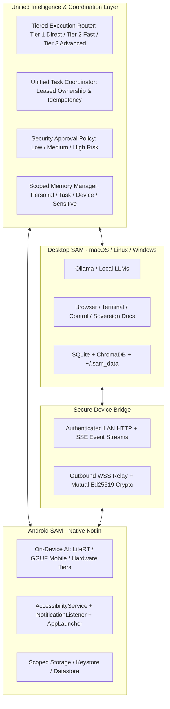

# SAM Unified Cross-Device AI Agent — Master Architecture Blueprint

## 1. System Architecture Overview

SAM is a sovereign, private, cross-device AI assistant operating seamlessly across desktop computers and Android mobile devices.



---

## 2. Dual-Device Intelligence & Capability Routing

Both devices possess inference and execution capabilities, but tasks are coordinated to prevent duplicate actions:

| Capability / Scenario | Execution Target | Rationale |
|:---|:---|:---|
| **Launch Android Application** | Android | Dispatched via `AndroidAppLauncher` Intents. |
| **Control Desktop Application** | Desktop | Handled via desktop `ComputerController`. |
| **Analyze Local Document** | Desktop | Handled via Sovereign Mode PDF/Word tools. |
| **Summarize Phone Notifications** | Android -> Desktop | Android collects notifications -> desktop creates docx report. |
| **Transfer File from PC to Phone** | Desktop -> Android | Desktop locates file -> transfers via bridge -> phone saves in Scoped Storage. |
| **Deterministic Math / Screenshot** | Local (Direct) | Sub-millisecond execution bypassing LLM. |
| **Offline Autonomous Command** | Local Device | Executes on whichever device the user is interacting with. |

---

## 3. Leased Task Ownership Protocol

Every cross-device task follows an explicit ownership lease protocol (`connect/services/coordinator.py`):
1. **Creation**: Task is minted with unique `task_id` (`task_<uuid>`) and optional `idempotency_key`.
2. **Lease Grant**: An `ExecutionLease` is issued to the target device with a 60-second lease window.
3. **Heartbeat & Renewal**: The executing device continuously renews its lease during progress.
4. **Reconnection Safety**: If a device disconnects, the lease remains unexpired for the remaining window. No other device can execute the same task. If the lease expires, the coordinator can gracefully re-queue or recover the task.
5. **Handoff**: When a task moves between devices, the old lease is explicitly revoked, and a new lease is minted for the recipient device.
6. **Terminal State**: Upon completion or failure, the lease is revoked immediately.

---

## 4. Android Local AI Inference Engine

Mobile inference runs locally on the phone (`SamMobileInferenceEngine.kt`):
- **Hardware Tiers**:
  - **Low Tier (<= 4 GB RAM)**: 1B–2B models (e.g., SmolLM, Gemma 2B, LiteRT quantized).
  - **Medium Tier (6–8 GB RAM)**: 3B–4B models (e.g., Qwen 2.5 3B, Phi-3.5 mini).
  - **High Tier (>= 12 GB RAM / Flagship NPU)**: 7B–8B models (e.g., Qwen 2.5 7B Q4_K_S).
- **Runtimes**:
  - LiteRT (TensorFlow Lite runtime optimized for Android NPU/GPU).
  - llama.cpp mobile runtime for direct GGUF inference.
- **Diagnostics**:
  - Live RAM consumption monitoring.
  - Token generation speed (tokens per second).

---

## 5. Security & Privacy Architecture

- **Cryptographic Device Identity**: Ed25519 keypairs generated per device; private keys never leave the device.
- **Replay Protection**:
  - Signed requests contain `X-SAM-Timestamp` and `X-SAM-Nonce`.
  - Server enforces a strict 120-second timestamp validity window.
  - Nonce cache rejects duplicate requests within the window.
- **Approval Gating**:
  - Low Risk (calculations, reading public docs, taking screenshots): Executed directly.
  - Medium Risk (launching apps, creating files): Configurable approval.
  - High Risk (deletions, payments, shell commands): Mandatory user confirmation.
- **Scoped Context Isolation**:
  - Sensitive keys, API tokens, and device-local hardware states are explicitly isolated and never transmitted across the network.

---

## 6. How to Build & Run

### A. Desktop SAM
```bash
# 1. Install dependencies
pip install -r requirements.txt

# 2. Run offline test suite
PYTHONPATH=$(python3 -m site --user-site) python3 tests/test_tiered_execution_and_coordinator_offline.py

# 3. Start SAM Assistant
python3 main.py --text
```

### B. Android SAM
```bash
# 1. Navigate to android project
cd sam-android

# 2. Build debug APK
./gradlew assembleDebug

# 3. Run Android unit tests
./gradlew testDebugUnitTest

# 4. Generate Google Play App Bundle (AAB)
./gradlew bundleRelease
```
